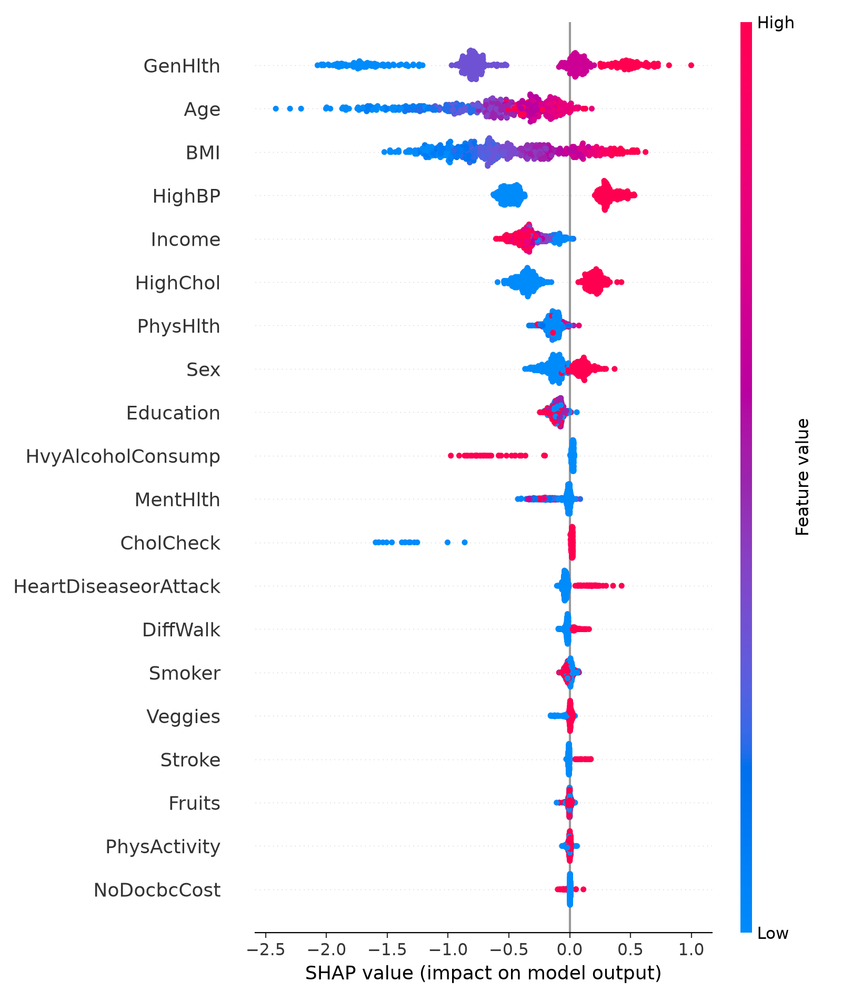

# Two-Stage Machine Learning Cascade for Type 2 Diabetes Risk Screening

An MSc Information and Communication Technology research project exploring machine-learning approaches to identifying indicators associated with Type 2 diabetes in public health survey data.

> **Research/educational prototype only.** This project is not a clinical diagnostic tool or a validated medical risk calculator.

## Project overview

This project compares Logistic Regression, Random Forest and XGBoost, investigates a stacking ensemble, and experiments with a two-stage cascade:

1. **Stage 1:** Logistic Regression identifies a broad group for further screening using a low probability threshold (0.15).
2. **Stage 2:** XGBoost refines the classification of cases flagged by Stage 1.

The analysis also explores class imbalance, model evaluation and interpretability.

## Dataset

- **Source:** [UCI Machine Learning Repository — CDC Diabetes Health Indicators](https://archive.ics.uci.edu/dataset/891/cdc+diabetes+health+indicators)
- **Records:** 253,680
- **Input features:** 21, including BMI, age category, blood pressure, cholesterol, physical activity and general health indicators
- **Target:** `Diabetes_binary`
- **Original context:** CDC Behavioral Risk Factor Surveillance System (BRFSS) survey data

**Dataset clarification:** Although the broader MSc research concerned diabetes risk prediction and electronic health records, the implementation published here uses *survey-derived health indicators*, not a longitudinal electronic health record dataset. The script fetches the data programmatically; no dataset is included in this repository.

## Methods and tools

- Python, pandas, NumPy and Matplotlib
- scikit-learn: train/test split, StratifiedKFold, GridSearchCV, Logistic Regression, Random Forest, stacking and evaluation metrics
- imbalanced-learn: SMOTE within model-training pipelines
- XGBoost: gradient-boosted classification
- SHAP: interpretation of the XGBoost model

## Results saved in the submitted notebook

| Experiment | Result |
|---|---:|
| Logistic Regression cross-validation ROC-AUC | 0.8225 |
| Random Forest cross-validation ROC-AUC | 0.8213 |
| XGBoost cross-validation ROC-AUC | 0.8282 |
| Stacking ensemble ROC-AUC on held-out split | 0.8242 |
| Two-stage cascade (threshold 0.256) accuracy | 0.8044 |
| Two-stage cascade precision | 0.3751 |
| Two-stage cascade recall | 0.6063 |
| Two-stage cascade F1-score | 0.4635 |

**Important evaluation limitation:** The notebook selects the second-stage decision threshold using labels from the same test split on which the cascade's final performance is reported. Therefore, the final cascade metrics are **exploratory and potentially optimistic**, not an unbiased held-out test estimate. A future revision should choose the threshold using a separate validation split or cross-validation, then evaluate on a previously untouched test set. The stacking comparison also juxtaposes a test-set ROC-AUC with a baseline cross-validation ROC-AUC; these are not directly comparable estimates.

## Project files

- `diabetes_risk_prediction.ipynb` — notebook with code, explanations and saved results
- `diabetes_risk_prediction.py` — Python script version of the analysis
- `shap_summary.png` — saved SHAP summary visualisation
- `requirements.txt` — Python dependencies
- `.gitignore` — excludes local environments, temporary files and datasets

## How to run

1. Install Python and create a virtual environment.
2. Install dependencies:

   ```bash
   python -m pip install -r requirements.txt
   ```

3. To run the script:

   ```bash
   python diabetes_risk_prediction.py
   ```

   Or start Jupyter and open `diabetes_risk_prediction.ipynb`:

   ```bash
   jupyter notebook
   ```

The script retrieves the dataset from UCI using `ucimlrepo`, so **internet access is required for the initial fetch**. Training and grid searches may take time depending on hardware. The dependency list is unpinned because the exact versions used for the original run were not captured; results may differ across environments and package versions.

## Explainability

The notebook inspects Logistic Regression coefficients for Stage 1 and uses SHAP to visualise feature contributions in the XGBoost model.



## Limitations and future improvements

- Separate threshold selection from final test evaluation.
- Compare models on consistent evaluation splits and metrics.
- Pin and test package versions for reproducibility.
- Examine calibration, subgroup performance and external validation before considering any practical screening use.
- Document the dataset's limitations, including self-reported survey indicators and non-clinical use.

## Author

Brian Kirui — MSc Information and Communication Technology (Distinction), Anglia Ruskin University.
